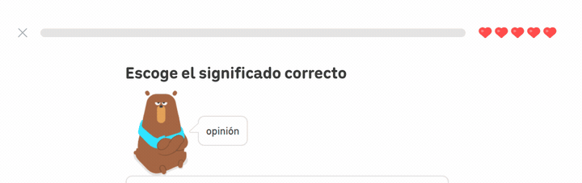
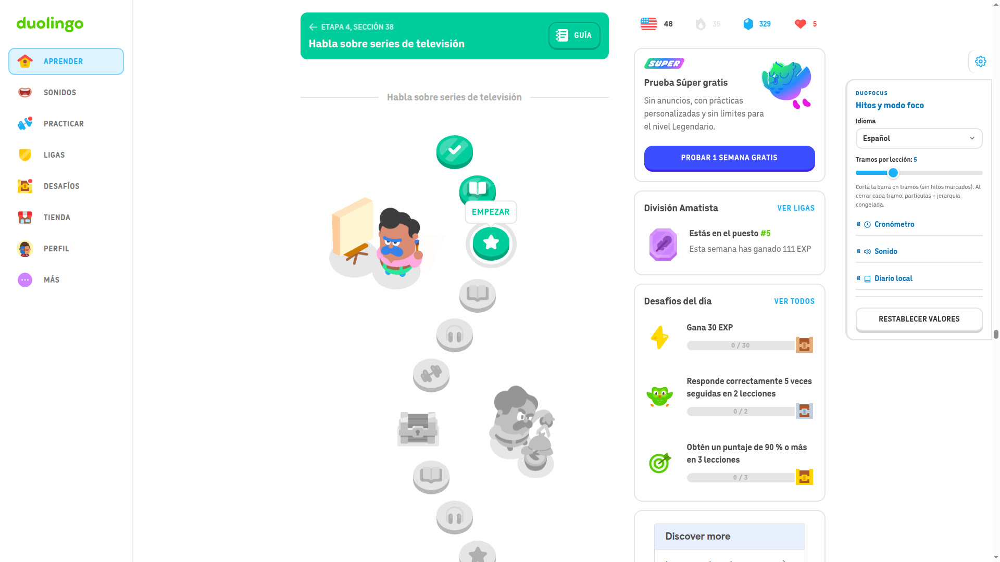

# DuoFocus — milestones, timer & rewards

<div align="center">

[](LICENSE)
[](https://www.tampermonkey.net/)
[](https://greasyfork.org/es-419/scripts/590127)
[](https://greasyfork.org/es-419/scripts/590127-duolingo-adhd-progress-bar-milestones-for-the-easily-distracted-bored)

</div>



Duolingo's progress bar is one long uniform line: no landmarks, no sense of having closed a chunk, no feedback on pace. DuoFocus splits that line into segments, gives each one a **tier** — Wood → Bronze → Silver → Streak → Diamond → **Super** — and races you down that ladder while you take too long on it.

- **Segments, not a line.** Each one carries a material tier with its own texture, colour and signature animation.
- **A timing strip above the bar.** Tier name, budget rail and lap clock in one object, so the pace is a single thing to read.
- **Laps, not a countdown.** The rail holds one tier for the whole lap; when it runs out it recharges **one tier lower**. The tier you freeze is the one the rail was showing **at the moment you closed** — not the best one you brushed earlier.
- **You never lose.** Wood is the floor, laps keep counting, and running long simply costs you tiers. The bar ends up a record of how the lesson actually went.

Built for people who lose focus on long uniform tasks. It is a cosmetic and pacing layer over Duolingo's own bar — it doesn't measure, diagnose or treat anything.

## Index

[The tiers](#the-tiers) · [Install](#install) · [Settings](#settings) · [Sound](#sound) · [Privacy](#privacy) · [Development](#development) · [Roadmap](#roadmap) · [License](#license)

## The tiers

| Tier | On closing the segment | Sound |
|---|---|---|
| **Wood** | particles | unpleasant (a dull thud) |
| **Bronze** | particles | unpleasant (a dead scrape) |
| **Silver** | particles | unpleasant (a flat buzz) |
| **Streak** | animated flames, full screen | satisfying |
| **Diamond** | faceted crystals, full screen | satisfying |
| **Super** | a shower of Duo, full screen | satisfying |

Wood is the floor: you never lose, you lose tier.

---

## Install

1. Install a userscript manager: [Tampermonkey](https://www.tampermonkey.net/), Violentmonkey or Greasemonkey.
2. Install the script from Greasy Fork: **https://greasyfork.org/es-419/scripts/590127**
3. Open any lesson or practice session. The bar splits itself; the tab on the right edge opens the settings.

The script updates itself through Greasy Fork once installed.

> When you install (or update to) a version with the desktop reminder, Tampermonkey asks once for the **notifications permission** — that's the manager asking, not duolingo.com. Denying it leaves the audible-only path.

## Settings

Everything applies live, no reload. Open the panel with the tab docked to the right edge.

### English

| Control | Default | What it does |
|---|---|---|
| **Language** | your browser locale | Panel UI (`es` / `en`). |
| **Segments per lesson** | **5** (4 separators) | How many pieces the bar is split into. 2–13. Fewer = longer chunks; more = more frequent feedback. |
| **Timer mode** | **on** | Per-lap time budget with the tier ladder racing you down. Off gives the plain positional tier ladder, no clock. |
| **Goal (sec)** | **2m 0s** | Time budget per lap, the only difficulty dial. Short on purpose: a lap has to fit inside a lesson, or the ladder never drops and the dial does nothing. |
| **+ seconds** | **0s** | Fine adjustment on top of the minutes, in 5s steps. |
| **Reward effects** | **on** | Full-screen celebration when a segment closes on a high tier: **Streak** → animated flames, **Diamond** → faceted crystals, **Super** → a shower of Duo. Lower tiers keep the particle burst. |
| **Test effects** | — | Cycles all six bursts on the live bar. |
| **Animations** | **respect system** | Follows the desktop's reduced-motion setting; **always** forces every effect on, **never** calms them all. Affects this script only. |
| **Tier sounds** | **on** | A short cue per closed segment: satisfying on **Streak / Diamond / Super**, unpleasant on **Wood / Bronze / Silver**. |
| **Periodic reminder** | **on** | A soft nudge while duolingo.com is open, on any screen. It only sounds when you're **not** using the page (45 s without interacting, or the tab hidden). |
| **Every** | **1m** | Reminder interval: 15 s – 15 min in 15 s steps. |
| **Test sound** | — | Plays the reminder cue immediately. |
| **Local journal** | **off** | Lessons, segments, average time, day streak. Nothing is recorded until you enable it. |
| **Reset values** | — | Restores all defaults (keeps your language). |

### Español

| Control | Por defecto | Qué hace |
|---|---|---|
| **Idioma** | el locale del navegador | Interfaz del panel (`es` / `en`). |
| **Tramos por lección** | **5** (4 separadores) | En cuántos trozos se divide la barra. 2–13. Menos = trozos más largos; más = feedback más seguido. |
| **Modo tiempo** | **activado** | Presupuesto por vuelta con la escalera bajándote. Apagado queda la escalera posicional, sin cronómetro. |
| **Objetivo (seg)** | **2m 0s** | Presupuesto de cada vuelta, el único dial de dificultad. Corto a propósito: una vuelta tiene que caber en una lección, si no la escalera nunca baja y el dial no hace nada. |
| **+ segundos** | **0s** | Ajuste fino sobre los minutos, en pasos de 5s. |
| **Efectos de recompensa** | **activado** | Celebración a pantalla completa al cerrar un tramo de peldaño alto: **Racha** → llamas, **Diamante** → cristales, **Super** → lluvia de Duo. |
| **Probar efectos** | — | Cicla los seis bursts sobre la barra real. |
| **Animaciones** | **respetar sistema** | Sigue la preferencia de movimiento reducido del escritorio. **Siempre** fuerza todo, **nunca** calma todo. Afecta solo a este script. |
| **Sonidos por peldaño** | **activado** | Un cue por tramo cerrado: satisfactorio en **Racha / Diamante / Super**, desagradable en **Madera / Bronce / Plata**. |
| **Recordatorio periódico** | **activado** | Un aviso suave mientras duolingo.com está abierto, en cualquier pantalla. Solo suena si no estás usando la página (45 s sin interacción, o pestaña oculta). |
| **Cada cuánto** | **1m** | Intervalo del recordatorio: de 15 s a 15 min, en pasos de 15 s. |
| **Probar sonido** | — | Suena el recordatorio al toque (y desbloquea el audio del navegador). |
| **Diario local** | **desactivado** | Lecciones, tramos, tiempo medio y racha de días. Nada se registra hasta que lo actives. |
| **Restablecer valores** | — | Vuelve todo a los valores por defecto (conserva tu idioma). |

<div align="center">

<video controls preload="none" width="100%" style="max-width:720px;border-radius:12px">
  <source src="demo.mp4" type="video/mp4">
  Your browser does not support embedded video — <a href="demo.mp4">download demo.mp4</a> instead.
</video>



</div>

## Sound

Two kinds, both in **Settings → Sound**:

- **A tier fanfare on every closed segment**, in the same instant as the burst and the freeze. Satisfying on the high tiers, deliberately unpleasant on the low ones. With timer mode off no tier is evaluated, so there is no fanfare.
- **A periodic reminder** while duolingo.com is open, on any screen. Default every **60 s**, configurable from 15 s to 15 min. It only plays when you're idle, and it never plays catch-up when you come back.

Both are embedded in the script as base64 `data:` URIs: they load instantly, work offline and can't be blocked by an extension. **Browser autoplay**: Chrome and Firefox hold all sound until you interact with the page once — the **Test sound** button does exactly that. A blocked cue is dropped silently; sound never blocks or breaks the lesson.

### Desktop notification when the tab is hidden

A reminder that falls due while the tab is in the background escalates to a **system notification**: the browser throttles hidden-tab timers to about one wake per minute, so a page-scheduled sound can't reach you on time — the OS's notification channel can.

It's the **userscript manager** (Tampermonkey), never duolingo.com, that shows it: the site is never asked for a notification permission. It ships **on by default**; one click in *Settings → Sound* turns it off, and with it off a hidden reminder simply waits and plays at most once when you return.

If nothing shows, the OS is almost always the one silencing it:

- **GNOME/Linux:** turn off *Do Not Disturb* and make sure notifications are enabled for your browser. On minimal setups, install a daemon (`mako`, `dunst`).
- **Windows:** check that *Focus Assist / Do Not Disturb* isn't suppressing them and that your browser isn't in the per-app block list.
- **Chrome:** in `chrome://settings/content/notifications`, make sure the userscript manager's entry isn't blocked.

### Replacing a sound

Every cue has two interchangeable sources, in this order: the embedded sample in `SOUND_SAMPLES` (inside `duolingo-adhd.user.js`), and a built-in synthesizer recipe in `SOUND_SYNTH`, always present as the fallback.

1. Generate the SFX (ElevenLabs SFX works, so does any other generator): short, no voice, no music bed.
2. Trim it and export **mono MP3** — this cuts at 1.6 s and fades the last 0.3 s so a long cue can't cover the next segment closing:

   ```bash
   ffmpeg -i cue.wav -af "atrim=0:1.6,afade=t=out:st=1.3:d=0.3" -ac 1 -ar 22050 -c:a libmp3lame -b:a 40k cue.mp3
   ```

3. Turn it into a data URI:

   ```bash
   echo -n "data:audio/mpeg;base64,$(base64 -w0 cue.mp3)"
   ```

4. In `duolingo-adhd.user.js`, find `const SOUND_SAMPLES = {` and paste the string as the value for that cue's key (`super`, `diamante`, `racha`, `plata`, `bronce`, `madera`, `reminder`).
5. Stay inside the budget: **≤ ~20 KB of base64 per cue, ≤ ~100 KB in total** (the seven shipped samples are ~61 KB together). If one doesn't fit, shorten it or set the value to `''` — the synthesizer takes over.

Nothing else changes: the trigger, the panel and the tests only care about the cue id.

<details>
<summary>The prompts used for the shipped samples</summary>

| Cue | Character | Prompt |
|---|---|---|
| `super` | satisfying, the finale | *Short rewarding game reward jingle, ascending four-note sparkle arpeggio, bright bell and soft chime blend, triumphant but not loud, clean tail, 0.6 seconds, no voice, no music bed* |
| `diamante` | satisfying, crystalline | *Single bright crystal chime, glassy bell hit with a fast shimmering decay, premium and satisfying, 0.5 seconds, no voice, no music bed* |
| `racha` | satisfying, quick | *Quick three-tone rising arcade blip, playful and positive, snappy attack, 0.35 seconds, no voice, no music bed* |
| `plata` | unpleasant, flat | *Dull flat two-tone buzzer, slightly detuned and anticlimactic, unimpressed sound, 0.4 seconds, no voice, no music bed* |
| `bronce` | unpleasant, dull | *Low dull thud with a short filtered noise scrape, heavy and disappointing, 0.3 seconds, no voice, no music bed* |
| `madera` | unpleasant, ugly on purpose | *Descending wobbly low woodblock wobble, clumsy and comical failure sound, cheap and scratchy, 0.45 seconds, no voice, no music bed* |
| `reminder` | a nudge, not an alarm | *Two soft hollow owl hoots, a calm distant bird call used as a gentle attention-getting nudge, warm and non urgent, 0.8 seconds, no voice, no music bed* |

</details>

The shipped samples are trimmed to ≤ 1.9 s and normalised to **≈ -18.5 LUFS (true peak between -2.6 and -10 dBTP)**, so all seven sit at the same perceived volume. Match by ear or with `ffmpeg -af ebur128`.

## Privacy

- **Nothing leaves your browser.** No server, no account, no analytics. Settings and journal live in your userscript manager's local storage.
- The only network request is the Baloo 2 font for the clock, and it falls back to a system font if blocked.
- The sounds and the reward effects are embedded in the script: no audio or animation is ever downloaded.
- The desktop notification is emitted by the userscript manager, not by duolingo.com.

## Development

`npm test` is the red→green loop (unit suite, ~0.4 s). The heavier layers are run by hand: `npm run test:e2e` (headless browser against a frozen replica of duolingo.com), `npm run mutate` (47 mutants; a survivor is a coverage gap), `npm run test:vendor` (third-party module diff, needs files outside the repo) and `npm run test:live` (the real site, needs a logged-in session). There is no CI.

Field QA is issue-triggered: when something is reported about the real site, a question form is generated from `qa/plantilla-guion.html`, the evidence is the live probe's dump, and the filled form exports a report under `qa/reports/`.

## Roadmap

1. **UX improvements.** Continued polish on the strip, the panel and how the lap ladder reads at a glance.
2. **More features in other areas.** Beyond the progress bar.

Suggestions are welcome — open an issue with what you were doing, what you expected, what happened instead, and your browser plus Duolingo's UI language. A screenshot helps a lot on visual things.

## License

MIT — see `LICENSE`. A personal project, not affiliated with or endorsed by Duolingo.
